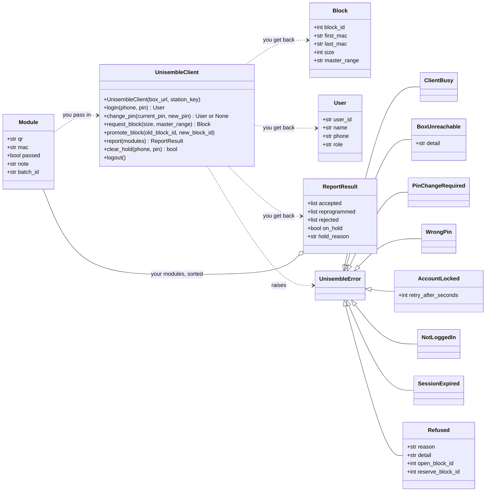

SDK version 7.0.0

# Station Application Developer Guide

**Reader:** a Python developer at Unisem building the station application, who has not seen this system before.
**SDK:** `unisemble_client` 7.0.0, for the 7.0 box. A station on an older SDK does not work with a 7.0 box, and a 7.0 station does not work with an older box: upgrade the box and every station together.
**Status:** describes the SDK and box as built.

Contents:

1. Overview
2. Before you start
3. Class diagram
4. How a station uses the SDK, step by step
5. Class reference
6. Errors
7. Appendix: HTTP wire format (for non-Python clients)
8. Appendix: Changes from 5.x
9. Appendix: What changed in 7.0

The rules a production station application keeps (for design reviews and acceptance testing) are in [STATION-APP-REQUIREMENTS.md](STATION-APP-REQUIREMENTS.md).

---

## 1. Overview

**The box** is the local server on the site. It owns the site's BLE MAC addresses, hands each station its own blocks of them, and keeps the record of which address is on which module. It is paired with a head-office server; the station application never talks to head office.

**The station application** runs on one production PC with one jig. It programs MAC addresses into modules, using only addresses the box gave it. Its process (detect, program, test, re-test, whatever Unisem needs) is its own; the box does not know or care about the steps.

**The SDK** (`unisemble_client`) is a Python package with one class, `UnisembleClient`, and four small data classes. It makes the HTTP calls, the request ids and the retries. It never talks to the hardware.

```
+-----------------------+        +-------------------+      HTTP / JSON      +-------+
|  Station application  | -----> |  UnisembleClient  | --------------------> |  Box  |
|  (jig, screens,       |  calls |                   |  station key on       |       |
|   saved state)        | <----- |                   |  every request        |       |
+-----------------------+ results+-------------------+ <-------------------- +-------+
```

The station talks to the box at only a few moments:

- when someone logs in, changes their PIN, or logs out;
- when it needs a new block of addresses, and when it switches from one block to the next;
- **once per finished tray**, to say which module got which address and whether it passed;
- when a supervisor clears a hold at the station.

### Words used in this guide

| Word | Meaning |
|---|---|
| Station key | A secret issued for one station on the box console. It names the site and the station. The SDK sends it on every call. |
| Master range | A named pool of addresses on the box for one product family. A module gets its address from the master range it is built for. |
| Block | A run of consecutive addresses, from `first_mac` to `last_mac` (both included), given to this station from one master range. The station owns it and uses it from the bottom up. |
| Current block | The block the station is programming from. |
| Reserve block | The next block, fetched before the current one runs out, so the line never waits for the box. |
| Promote | Telling the box the station has moved from one block to the next. The old block is closed and its unused addresses are never handed out again. |
| Report | The message sent once a tray is fully finished: for each module, its QR label, the MAC programmed into it, and whether it passed. |
| Hold | The box's signal that the line must stop until a supervisor has looked. A rejected module puts the station on hold; a supervisor can also put it on hold from the box console. |

---

## 2. Before you start

| You need | Where it comes from |
|---|---|
| The box URL | The "Workstation app (SDK base_url)" line on the box installer's finish page, e.g. `http://<box-host>:3001`. |
| A station key | Box console → **Stations**. Creating a station shows its key once. **Rotate key** issues a new one and the old one stops working at once. |
| Operator and supervisor phone numbers and PINs | Registered at head office; they reach the box from there. A PIN is 6 digits. |
| The master-range name for each product | Box console → **Pools**. |

```bash
pip install unisemble_client-7.0.0-py3-none-any.whl
python unisem-station-src/examples/jig_cycle.py --demo     # runs against an in-memory demo box
```

---

## 3. Class diagram

The application creates a `UnisembleClient`, passes `Module` objects in, and gets `User`, `Block` and `ReportResult` objects back. Every error is a `UnisembleError`.


<details><summary>Mermaid source</summary>



</details>

---

## 4. How a station uses the SDK, step by step

This section follows one station through a shift. The snippets follow `unisem-station-src/examples/jig_cycle.py`; names such as `save_state()`, `program()`, `show()` and `ask_pin()` stand for the application's own code.

### 4.1 Start-up

The application creates one client for the life of the program. Nothing is sent yet.

```python
from unisemble_client import UnisembleClient, Module, errors

client = UnisembleClient("http://<box-host>:3001", "<station-key>")
```

It then loads its saved state (section 4.4): the current block, the reserve block if it has one, the position reached in the current block, any promote it still owes the box, and any finished modules not yet reported.

### 4.2 Login

The operator types their phone number and PIN. The client keeps the session for later calls; `login()` returns the `User` who is now logged in (5.5), so the application can show the screens for their `role`. A client holds one person: `login()` first logs out whoever was logged in on it, whatever the outcome of the new login.

```python
try:
    user = client.login(phone, pin)
except errors.PinChangeRequired:
    new_pin = ask_new_pin()
    user = client.change_pin(pin, new_pin)   # also logs the operator in, and returns the User
except errors.WrongPin:
    show("Phone number or PIN not recognised.")
except errors.AccountLocked as e:
    show(f"Too many wrong PINs. Try again in {e.retry_after_seconds // 60 + 1} minutes.")
```

A login at a station that already has someone logged in ends the earlier session.

### 4.3 Changing a PIN

There is one call for both cases. The person always gives their current PIN.

- **Forced.** The first login with a PIN issued at head office raises `PinChangeRequired`. The application asks for a new PIN and calls `change_pin(pin_just_typed, new_pin)`. Once the change succeeds the client logs the operator in with the new PIN and `change_pin()` returns the `User`, so the application carries on as after a normal login.
- **Voluntary.** An operator who thinks their PIN has been seen can change it at any time while logged in: `client.change_pin(current_pin, new_pin)`. The session carries on and `change_pin()` returns `None`.

`change_pin()` changes the PIN of the person of the last `login()`: logged in, or refused with `PinChangeRequired`. A wrong current PIN raises `WrongPin` and counts towards the same lock-out as a wrong login. `change_pin()` with no one logged in (before any `login()`, after `logout()` or after `SessionExpired`) raises `NotLoggedIn`, because the client does not know whose PIN to change.

### 4.4 Getting a block and saving the position

The application asks for a block for the master range of the product being built. It chooses the size: a larger block means fewer trips to the box (1,000 to 20,000 is normal).

```python
block = client.request_block(5000, "UNISEM-A")
state.current = block
state.position = 0                 # how many addresses of the block are used
save_state(state)
```

From here the block is the application's. It hands out addresses itself, from `first_mac` upwards, and **saves the new position to disk before programming** each tray:

```python
from unisemble_client import mac_to_int, int_to_mac

n = len(tray)                                        # up to 8
first = mac_to_int(state.current.first_mac) + state.position
state.position += n
save_state(state)                                    # saved BEFORE the first module is programmed
macs = [int_to_mac(first + i) for i in range(n)]
```

Saving first means a crash or power cut can only leave some addresses unused; it can never hand the same address to two modules. That is the one rule that keeps addresses unique, and the box cannot enforce it for the application.

Addresses skipped in the middle of the current block (for example after a crash) are noticed by the box: when a report jumps past addresses that were never reported, the box puts the station on hold so a supervisor can look. Leaving the unused tail of a block behind when switching blocks does not do this.

### 4.5 Fetching the reserve and switching blocks

When the current block runs low (the threshold is the application's choice), it calls `request_block()` again with the same master range. The box gives it a second block, the reserve.

```python
if remaining(state) <= LOW_WATER and state.reserve is None:
    state.reserve = client.request_block(5000, "UNISEM-A")
    save_state(state)
```

The box refuses a third block while an un-switched reserve is held (`Refused`, reason `reserve_already_held`).

When the current block is used up, the application moves to the reserve **at once**, in the same saved write, and then tells the box:

```python
old, new = state.current, state.reserve
state.current, state.reserve, state.position = new, None, 0
state.owed_promote = (old.block_id, new.block_id)
save_state(state)

client.promote_block(*state.owed_promote)
state.owed_promote = None
save_state(state)
```

If the box cannot be reached, the promote stays owed in the saved state and is sent once the box answers, before any new `request_block()`. The line does not wait for it: the box accepts reports of addresses from the station's reserve block before the promote arrives. A tray never spans two blocks; a short last tray, or leaving the last few addresses of a block unused, are both fine.

### 4.6 Reporting a finished tray

When the station's own process for a tray is completely finished, whatever steps it ran, the application reports it once:

```python
result = client.report([
    Module(qr="U2610300001", mac="70B3D5A00001", passed=True, batch_id="S5A01"),
    Module(qr="U2610300002", mac="70B3D5A00002", passed=False, note="AT test: no RF", batch_id="S5A01"),
])
```

Every module that had an address programmed into it goes in, passed or failed. `note` is free text for a person reading the record later. A report may hold modules from several trays (see 4.9).

Every module carries its **batch ID**: the production batch it belongs to, e.g. `"S5A01"` (station S5A, batch 01). It is required. It is free text, 1 to 64 printable ASCII characters (letters, digits, spaces, punctuation); surrounding spaces are removed. A module with no batch ID, or one that breaks that rule, raises `InvalidBatchIdError` before anything is sent, naming the module's QR; nothing is reported and the client is ready for the next call. Pass it by name (`batch_id="S5A01"`). The batch ID shows on every trace screen and report, beside the module's week (WWYY, the week of the year it was first reported).

A module keeps the batch ID and week of its **first** report. A re-test reported later in another batch keeps the module's first batch ID (the re-test's batch is still recorded with that report). A re-programmed module (same QR, new address) keeps the batch ID and week of the module it replaced.

The client gives each `report()` call an id and re-sends it if the answer is lost. Sending the same report again returns the same answer.

### 4.7 Handling the result

The result sorts the application's own `Module` objects into three lists:

| List                  | Meaning                                                                                                                                               | What the application usually does                                                                 |
| --------------------- | ----------------------------------------------------------------------------------------------------------------------------------------------------- | ------------------------------------------------------------------------------------------------- |
| `result.accepted`     | The box recorded the module with this address. A failed module is recorded too, as failed.                                                            | Nothing more.                                                                                     |
| `result.reprogrammed` | The box already had this QR with a different address. It recorded the new address and marked the old one as unused.                                   | Nothing more; normal when a module is re-programmed after a fault.                                |
| `result.rejected`     | `(module, reason)` pairs. `"duplicate"`: the address is already on another module. `"not_this_station"`: the address was never given to this station. | Shows the operator which module, and keeps it apart. The box has already put the station on hold. |

```python
for module, reason in result.rejected:
    show_rejected(module.qr, module.mac, reason)
if result.on_hold:
    open_hold_screen(result.hold_reason)
```

`result.on_hold` is true while the station has any open hold, whether from this report, an earlier one, or a supervisor on the box console. `hold_reason` says why in words: when this report caused the hold, it explains this report's rejection; otherwise it gives the oldest open hold.

| Reason | Words for the operator |
|---|---|
| `duplicate` | "This address is already on another module. Two modules must never share an address. Take this module out and keep it apart." |
| `not_this_station` | "This address was never given to this station. Take this module out and keep it apart." |

### 4.8 The hold screen and `clear_hold`

While on hold the application stops starting new trays. Trays already in progress may finish and be reported; the box still records them.

The hold screen shows the reason and a button for the supervisor. The supervisor types their own phone number and PIN on the station:

```python
try:
    if client.clear_hold(sup_phone, sup_pin):
        close_hold_screen()
    else:
        show("This person cannot clear holds: not a supervisor, or they must set a new PIN first.")
except errors.WrongPin:
    show("Phone number or PIN not recognised.")
```

`True` means every hold on this station is cleared (or there was none). The box records who cleared it and when. `False` means the person may not clear holds, and nothing changed: they are not a supervisor, or they are a supervisor who must set a new PIN before doing anything else. A wrong PIN locks that phone out exactly as a wrong login would. The operator stays logged in throughout; the supervisor is never logged in to the station.

Clearing the hold at the station does not decide what happens to a rejected module; that is done on the box console.

### 4.9 When the box cannot be reached, and `ClientBusy`

The SDK retries a call that gets no answer for about 20 seconds, then raises `BoxUnreachable`. During that time the client is **busy**: any other call on it raises `ClientBusy` at once, without sending anything.

This is why the application normally runs `report()` on a worker thread and does not wait for it. The jig keeps going. Modules finished while the client is busy, or while the box is unreachable, are kept by the application and sent together in the next `report()`:

```python
def send_pending():
    batch = list(state.pending)                 # finished, not yet reported
    try:
        result = client.report(batch)
    except (errors.ClientBusy, errors.BoxUnreachable):
        return                                  # keep them; try again after the next tray
    except errors.SessionExpired:
        ask_operator_to_log_in()                # keep them; they are sent after the next login
        return
    state.pending = state.pending[len(batch):]
    save_state(state)
    handle(result)
```

After `BoxUnreachable` the box may or may not have recorded those modules. Sending them again is safe: a module the box already has comes back `accepted`.

A report is only recorded against a logged-in operator. If the box has ended the operator's session (idle for 2 hours, the 12-hour limit or a shift boundary, the account disabled, or another login at this station), `report()` raises `SessionExpired` and nothing is recorded. The operator logs in again and the application sends the same modules. Report finished modules before `logout()`.

The line keeps running while the box is unreachable, for as long as the application has addresses: to the end of the current block, then through the reserve (switching at once, 4.5). When both are used up, the application stops and tells the operator it is waiting for the box. It never invents an address.

### 4.10 Logout

```python
client.logout()
```

The box records the logout time. The client forgets the session whatever the answer, and does nothing if no one is logged in.

### 4.11 Lost saved state

If the saved state is lost, damaged, restored from a backup or copied from another PC, the application does **not** try to rebuild its position: it could re-use addresses already programmed. It asks for a fresh block and closes whatever the box thinks it holds:

```python
try:
    state.current = client.request_block(5000, "UNISEM-A")
except errors.Refused as e:
    if e.reason != "reserve_already_held":
        raise
    client.promote_block(e.open_block_id, e.reserve_block_id)   # closes the old current block
    state.current = client.request_block(5000, "UNISEM-A")
state.position, state.reserve = 0, None
save_state(state)
```

The block it gets may be one the box files as a reserve; the application can program from it straight away. The next time it asks for a reserve, the box answers `reserve_already_held` again; the application promotes as above and asks once more. The old blocks' unused addresses are lost, which is acceptable; re-using any is not.

---

## 5. Class reference

Everything is importable from `unisemble_client`; the errors are also in `unisemble_client.errors`.

### 5.1 `UnisembleClient`

```python
UnisembleClient(box_url: str, station_key: str)
```

The connection to one box for one station. It holds the station key for its whole life and the operator session while someone is logged in. One call runs at a time.

A malformed `box_url` (not `http://` or `https://`, no host, or a port that is not a number) raises `ValueError` at once, when the client is created.

| Method | Returns | Can raise |
|---|---|---|
| `login(phone: str, pin: str)` | `User` | `PinChangeRequired`, `WrongPin`, `AccountLocked`, `Refused` (`not_allowed`: this account cannot operate a station) |
| `change_pin(current_pin: str, new_pin: str)` | `User` after a forced change (it logs the person in), otherwise `None` | `WrongPin`, `AccountLocked`, `NotLoggedIn`, `Refused` (`bad_request`: new PIN not 6 digits) |
| `request_block(size: int, master_range: str)` | `Block` | `Refused` (`master_range_unknown`, `master_range_used_up`, `reserve_already_held`, `bad_request`) |
| `promote_block(old_block_id: int, new_block_id: int)` | `None` | `Refused` (`block_not_found`) |
| `report(modules: list[Module])` | `ReportResult` | `SessionExpired`, `NotLoggedIn`, `Refused` (`bad_request`), `InvalidMacError`, `InvalidBatchIdError` |
| `clear_hold(phone: str, pin: str)` | `bool` | `WrongPin`, `AccountLocked` |
| `logout()` | `None` | — |

Every method can also raise `ClientBusy`, `BoxUnreachable` and `Refused` (`station_key_rejected`).

`request_block`, `promote_block` and `report` retry when there is no answer; `login`, `change_pin`, `clear_hold` and `logout` try once, because a PIN is never sent twice.

### 5.2 `Module`

```python
Module(qr: str, mac: str, passed: bool, note: str | None = None, batch_id: str | None = None)
```

One finished module, as passed to `report()`. Frozen. `batch_id` is required; it comes last, with a `None` default, only so that `Module(qr, mac, passed, note)` keeps putting the note in `note`. Always pass it by name.

| Attribute | Meaning |
|---|---|
| `qr` | The module's QR label. The box treats it as the module's identity. |
| `mac` | The address programmed into it: 12 hex digits. Lower case and a leading `0x` are accepted; colons are not. |
| `passed` | Whether the module passed the station's own process. |
| `note` | Optional free text, up to 500 characters. |
| `batch_id` | **Required.** The production batch, e.g. `"S5A01"`. 1 to 64 printable ASCII characters; surrounding spaces are removed. Missing or malformed: `report()` raises `InvalidBatchIdError`. |

### 5.3 `Block`

A block of addresses owned by this station. Returned by `request_block()`. Frozen.

| Attribute | Meaning |
|---|---|
| `block_id` | The id used in `promote_block()`. |
| `first_mac`, `last_mac` | First and last address, 12 upper-case hex digits, both included. |
| `size` | Number of addresses. |
| `master_range` | The master range it came from. |

### 5.4 `ReportResult`

The box's answer to `report()`.

| Attribute | Meaning |
|---|---|
| `accepted` | `list[Module]` — recorded. |
| `reprogrammed` | `list[Module]` — recorded with a new address; the old address is marked unused. |
| `rejected` | `list[tuple[Module, str]]` — not recorded; the reason is `"duplicate"` or `"not_this_station"`. |
| `on_hold` | `bool` — the station has an open hold. |
| `hold_reason` | `str` or `None` — why, in words. |

Every module sent appears in exactly one list, as the same object the application passed in, in the order sent.

### 5.5 `User`

The person logged in. Returned by `login()`, and by `change_pin()` when it logs a first-time user in. Frozen.

| Attribute | Meaning |
|---|---|
| `user_id` | The person's permanent id from head office, as a string of digits. The same on every box, and unchanged when their phone number changes. |
| `name` | Their name as registered at head office. |
| `phone` | Their phone number, e.g. `"+919800000001"`. |
| `role` | `"admin"`, `"supervisor"` or `"user"` on this site. A role changed at head office shows at the next login. |

### 5.6 MAC helpers

| Function | Does |
|---|---|
| `mac_to_int(mac)` | `"70B3D5A00001"` → integer, for counting through a block. |
| `int_to_mac(n)` | Integer → 12 upper-case hex digits. |

---

## 6. Errors

All SDK errors derive from `UnisembleError`, except `InvalidMacError` (a `ValueError`, for a MAC that is not 12 hex digits), `InvalidBatchIdError` (a `ValueError`, for a module whose `batch_id` is missing or not 1 to 64 printable ASCII characters; the message names the module's QR, e.g. `Module U2610300002: batch_id is required`) and the plain `ValueError` the constructor raises for a malformed `box_url`. Both are raised before anything is sent.

| Error | Meaning | What the application usually does |
|---|---|---|
| `ClientBusy` | Another call on this client has not finished. Nothing was sent. | Tries again later; for a report, keeps the modules for the next one. |
| `BoxUnreachable` | No usable answer after the retries: no connection, a time-out, a server error, or a box that is not ready yet (just installed, waiting for head office). `.detail` says which. | Keeps going on its own addresses; tries again later. |
| `PinChangeRequired` | Correct PIN, but a new one must be set. | Asks for a new PIN; calls `change_pin()`. |
| `WrongPin` | The phone and PIN were not accepted. | Asks again. |
| `AccountLocked` | Too many wrong PINs for that phone. `.retry_after_seconds`. | Shows how long to wait. |
| `NotLoggedIn` | `change_pin()` or `report()` with no one logged in. Nothing was sent. | Logs in first. |
| `SessionExpired` | `report()`: the box has ended the operator's session. Nothing was recorded. | Asks the operator to log in again, then sends the same modules. |
| `Refused` | The box refused the request. `.reason` says why (below); `.detail` is prose for support. | See below. |

| `Refused.reason` | Meaning | What the application usually does |
|---|---|---|
| `master_range_unknown` | No master range of that name on this box. | Stops: the configuration is wrong. Retrying gives the same answer. |
| `master_range_used_up` | Every address in that master range has been handed out. | Tells the operator; head office must add capacity. |
| `reserve_already_held` | The box already thinks this station holds a current and a reserve block. `.open_block_id`, `.reserve_block_id`. | Promotes the held pair (4.11), then asks again. |
| `block_not_found` | A promote named a block this station does not hold, or in the wrong order. | Calls support. |
| `not_allowed` | This account cannot operate a station. | Calls support. |
| `station_key_rejected` | The station key is wrong, rotated or revoked. | Calls support; a new key is issued on the console. |
| `bad_request` | The request was malformed (e.g. a PIN not 6 digits, more than 500 modules). | Calls support. |

---

## 7. Appendix: HTTP wire format

For clients not written in Python. All routes are under `/api/v1`; every request carries `Authorization: Bearer <station key>`; bodies are strict JSON; errors are problem+json `{type, title, status, detail}` with `type` ending in the slug.

| Route | SDK method | Body | Success |
|---|---|---|---|
| `POST /operator/login` | `login` | `phone`, `pin` | 201 `{ operator_session_token, operator, expires_at, clock_in_at }` |
| `POST /operator/change-pin` | `change_pin` | `phone`, `current_pin`, `new_pin` | 200 `{ ok }` |
| `POST /blocks/request` | `request_block` | `request_id` (UUID), `requested_size`, `master_range` | 201 `{ block_id, range_start, range_end, size, … }` |
| `POST /blocks/promote` | `promote_block` | `nonce` (UUID), `old_block_id`, `new_block_id` | 200 `{ outcome: "SATISFIED", … }` |
| `POST /reports` | `report` | `report_id` (UUID), `finished_at`, `modules` (1–500 × `{ qr, mac, passed, note?, batch_id }`) + `X-Operator-Session` | 200 `{ report_id, results: [ { qr, mac, outcome, reason? } ], on_hold, hold_reason }` |
| `POST /station/hold/clear` | `clear_hold` | `phone`, `pin` | 200 `{ cleared, cleared_by?, cleared_at? }` |
| `POST /operator/logout` | `logout` | `{}` + `X-Operator-Session` | 200 `{ clock_out_at, session_duration_s }` |

`batch_id` is required on every module: 1 to 64 printable ASCII characters, no leading or trailing space (the box does not trim it). A report with any module lacking a valid one is refused whole, nothing recorded: 400 `invalid-request`, `detail` e.g. `modules.3.batch_id: batch_id is required`.

A non-Python client makes a fresh UUID per logical request and sends the same id and body when it retries a time-out, a connection error, a 5xx or a 409 whose `type` starts with `pairing-` (box not ready). It does not retry any other 4xx; `login`, `change-pin`, `hold/clear` and `logout` are never retried.

How the SDK maps an answer (`type` slug, the part after the last `/`):

| Status and `type` | SDK error |
|---|---|
| 401 `invalid-credentials` | `WrongPin` |
| 409 `must-change-pin` | `PinChangeRequired` |
| 429 `account-locked` (header `Retry-After`) | `AccountLocked` |
| 401 `operator-session-expired` (on `/reports`) | `SessionExpired` |
| 401 `unauthorized`, 403 `station-mismatch` | `Refused` `station_key_rejected` |
| 403 `operator-identity-required` | `Refused` `not_allowed` |
| 404 `not-found` | `Refused` `master_range_unknown` (block request), `block_not_found` (promote) |
| 409 `pool-exhausted` | `Refused` `master_range_used_up` |
| 409 `reserve-already-held` (`open_block_id`, `reserved_block_id`) | `Refused` `reserve_already_held` |
| 409 with body `outcome: "NOT_YET"` (promote) | `Refused` `block_not_found` |
| 409 `pairing-…`, any 5xx, no answer | retried, then `BoxUnreachable` |
| any other 4xx | `Refused` `bad_request` |

---

## 8. Appendix: Changes from 5.x

- The two checks per tray (`verify` at the golden and read-back stages) and `commit_batch` are replaced by **one `report()` once a tray is fully finished**. The box no longer knows the station's process steps: no stage results, no dispositions, no `Gate`.
- `Module(qr, mac, passed, note)` replaces `VerifyEntry`, `BatchModule` and `ModuleEvent`.
- A QR reported again with a different address is **reprogrammed**, not refused.
- The box accepts addresses from the station's reserve block before `promote_block()`, so a station can switch at once when the box is unreachable.
- Holds are cleared at the station with `clear_hold(phone, pin)`, by a supervisor; a supervisor can also put a station on hold from the box console.
- `operator_login`, `operator_change_pin`, `operator_logout` are now `login`, `change_pin(current_pin, new_pin)`, `logout`. The change ticket is gone. `operator_heartbeat` is gone: each report counts as activity.
- Removed: `station_status`, `raise_hold`, `trace`, the cursor report, `degraded` warnings, and the device helpers. The box still puts the station on hold when a report skips addresses (4.4).
- Errors are reduced to eight classes; `ClientBusy` and `SessionExpired` are new.

---

## 9. Appendix: What changed in 7.0

- **Every module carries its batch ID.** `Module` gains `batch_id` (required, by name): `Module(qr, mac, passed, note=None, batch_id="S5A01")`. On the wire, each module in `POST /reports` carries `batch_id`.
- New error `InvalidBatchIdError` (a `ValueError`, beside `InvalidMacError`): a module with no batch ID or a malformed one. Raised by `report()` before anything is sent.
- The box records each module's batch ID and week (WWYY) from its first report, and shows both on its trace screens and reports.
- **Upgrade the box and every station together.** A 7.0 box refuses a report without batch IDs (an older station gets `Refused("bad_request", "400 invalid-request: modules.0.batch_id: batch_id is required")`); an older box refuses a report that carries them. Stop the line, let the stations finish reporting, upgrade the box, install the 7.0 station app on every station, start the line.
- Nothing else changed: the other calls, results and errors are as in 6.1.

